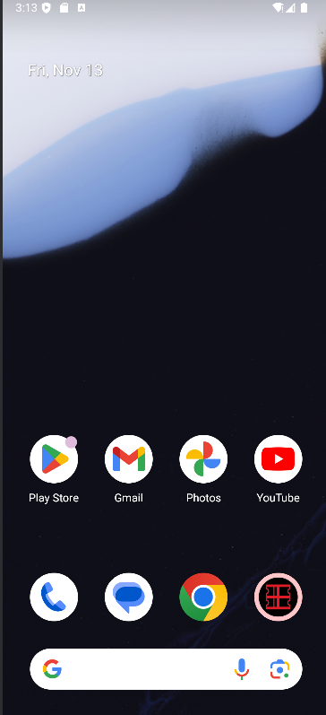

# EventCraft

Aplicativo mobile minimalista para gestão de eventos e controle de acesso (check-in), desenvolvido com **React**, **Vite** e **Capacitor** para Android. Projetado com uma interface de alto contraste em preto, branco e vermelho (`#000000`, `#FFFFFF`, `#E60000`).

## Funcionalidades

- **Seleção de Eventos:** Alternância rápida entre eventos ativos com métricas individuais.
- **Dashboard em Tempo Real:** Acompanhamento percentual e numérico de participantes credenciados.
- **Leitor de QR Code:** Validação instantânea de ingressos pela câmera com feedback visual imediato.
- **Busca de Participantes:** Pesquisa rápida por nome ou código para check-in manual.

## Capturas de Tela

| Ícone no Android
| :---: | :---: | :---: | :---: |
|  ||

## Tecnologias Utilizadas

- **Frontend:** React, Vite, Tailwind CSS, Lucide Icons
- **Mobile / Nativo:** Capacitor 7 (Android)
- **CI/CD:** GitHub Actions (build automatizado de APK)

## Como Executar Localmente

1. **Instale as dependências:**
   ```bash
   npm install